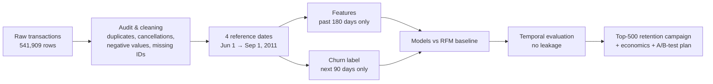
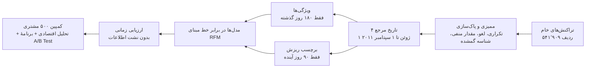

<div align="center">


<br/>

<a href="#english"><b>🇬🇧&nbsp;English</b></a> &nbsp;·&nbsp; <a href="#persian"><b>🇮🇷&nbsp;فارسی</b></a>

<br/><br/>


</div>

---

<a id="english"></a>

# 🇬🇧 English

> **Find the customers who are about to leave — before they leave.**
> An end-to-end data-mining project (CRISP-DM) on 540 K real online-shop transactions: audit the data, build a churn label from scratch, engineer behavioural features, evaluate with a leakage-free *temporal* design, and turn the model into a retention campaign you can defend to a manager.

<table>
<tr>
<td><b>📑 Contents</b></td>
<td>
<a href="#en-problem">Problem</a> ·
<a href="#en-data">Dataset</a> ·
<a href="#en-approach">Approach</a> ·
<a href="#en-time">Time design</a> ·
<a href="#en-features">Features</a> ·
<a href="#en-models">Models</a> ·
<a href="#en-campaign">Campaign</a> ·
<a href="#en-status">Status</a> ·
<a href="#en-findings">Findings</a> ·
<a href="#en-stack">Tech stack</a> ·
<a href="#en-install">Installation</a> ·
<a href="#en-reuse">Use your own data</a> ·
<a href="#en-faq">FAQ</a> ·
<a href="#contributors">Team</a>
</td>
</tr>
</table>

<a id="en-problem"></a>

## The Problem 🎯

An international online store notices that some long-time customers are **slowly buying less**, and others **silently stop buying** with no warning at all. By the time the business notices, it is too late to act.

There is one more catch: **the dataset has no "churn" column.** It only contains raw transactions — including cancellations, returns, negative values, missing customer IDs and very different customer behaviours.

**Our mission:** build an analytical system that, from raw transactions only,

1. 🔎 **predicts** each customer's churn risk,
2. 🧠 **explains** which behaviours are linked to churn,
3. 📞 **recommends** a retention campaign — with a budget to contact only **500 customers**.

> [!IMPORTANT]
> **The goal is *not* the highest possible accuracy.** The goal is to define a real problem correctly, turn raw data into valid features, evaluate the prediction with the *right* method, and use the model to support a **defensible business decision**.

**What kind of data-mining problem is it?** A **binary classification** task. The label is not given, so we *derive* it from future behaviour (look-ahead labelling):

> **Churn = 1** when a customer makes **no valid purchase in the 90 days after a reference date.**
> This is an analytical convention — it does not necessarily mean the customer is lost forever.

K-Means clustering is used only as an optional extension to segment customers and refine the retention strategy.

<a id="en-data"></a>

## Dataset 🛒

**Source:** [UCI Machine Learning Repository — Online Retail](https://archive.ics.uci.edu/dataset/352/online+retail) · transactions of a UK-based online shop, **Dec 2010 → Dec 2011**.

| Column | Meaning |
|---|---|
| `InvoiceNo` | Invoice number (starts with **C** → cancellation) |
| `StockCode` | Product code |
| `Description` | Product name |
| `Quantity` | Units per line (negative for cancellations/returns) |
| `InvoiceDate` | Transaction timestamp — the key column for features **and** label |
| `UnitPrice` | Price per unit |
| `CustomerID` | Customer identifier (≈ 25 % missing) |
| `Country` | Customer country |

<a id="en-approach"></a>

## The Approach 🧭

We follow all six phases of **CRISP-DM**:

<div align="center">

</div>



<a id="en-time"></a>

## Time Design — No Data Leakage ⏱️

This is the heart of the project. A model must be built **only with information that was available at the time**.

<div align="center">

</div>

```python
ref = pd.Timestamp("2011-07-01")                                   # reference date t

history = sales[(sales["InvoiceDate"] >= ref - pd.Timedelta(days=180)) & (sales["InvoiceDate"] < ref)]
future  = sales[(sales["InvoiceDate"] >= ref) & (sales["InvoiceDate"] < ref + pd.Timedelta(days=90))]

customers = history["CustomerID"].unique()                          # features come from `history` ONLY
churn = pd.Series(~pd.Index(customers).isin(future["CustomerID"]), index=customers)   # label from `future` ONLY
```

**Why not a random train/test split?** Transactions are sequential. A random split lets the model train on the *future* and be tested on the *past*, and puts the same customer's behaviour in both sets. The result looks great on paper and fails in real life. 🎭

<a id="en-features"></a>

## Feature Engineering 🧪

Every feature is documented with **how it is computed, what it means, and whether it can leak the future.**

| Family | Examples | Why it matters |
|---|---|---|
| **RFM** | Recency · Frequency · Monetary | The classic, strong baseline |
| **Behaviour change** | Invoices / spend in the last 90 days vs the 90 before, trend, change in purchase gap | Detects customers who are *slowing down* before they stop |
| **Diversity** | Unique products, average basket size, active days | Breadth of engagement |
| **Time pattern** | Customer age, observed span, average days between purchases, active months | Personal buying rhythm |
| **Cancellations** | Cancelled invoices, cancel rate, returned value (only from events *before* t) | Possible dissatisfaction signal |
| **Context** | Country (UK vs the rest) | Regional behaviour |

<a id="en-models"></a>

## Models & Evaluation 📊

| Model | Role |
|---|---|
| **RFM baseline** | The bar every complex model must beat |
| **Logistic Regression** | Interpretable linear model |
| **Decision Tree** | Human-readable rules |
| **Random Forest** | Bagged trees, robust to noise |
| **Gradient Boosting / XGBoost** | Strong tabular learner |

* All models use the **same feature set**; hyper-parameters are tuned **only on allowed (past) data**.
* **Metrics:** Precision · Recall · F1 · **PR-AUC** · ROC-AUC · Confusion Matrix · and **Precision@500** for the campaign.
  *Accuracy alone is never used to pick a model.*
* **Explainability:** feature importance, permutation importance, SHAP.
  Importance shows association, **not causation**.

<a id="en-campaign"></a>

## Retention Campaign 📞

With budget for **500 contacts**:

1. Rank customers by predicted churn risk.
2. Select the top 500 and explain the selection logic (risky only? risky **and** valuable?).
3. Split them into behavioural groups, each with its own action: discount offer, purchase reminder, related-product suggestion.
4. Compute campaign cost, expected profit and the **break-even success rate**.
5. Run a **sensitivity analysis** — how the decision changes when campaign cost or customer value changes.

> [!WARNING]
> This dataset **cannot prove** that a discount or a phone call prevents churn. That requires a controlled experiment (**A/B test**). All financial results are therefore reported with explicit assumptions.

<a id="en-status"></a>

## Project Status 🚦

| Phase | Deliverable | Status |
|---|---|---|
| 1 · Business Understanding | Problem, goals, success criteria, risks | ✅ Done |
| 2 · Data Understanding | 16-question exploration notebook | ✅ Done |
| 3 · Data Preparation | Audit, valid transactions, churn label for 4 reference dates | 🚧 In progress |
| 4 · Modeling | 4 models + RFM baseline | ⏳ Next |
| 5 · Evaluation | Temporal evaluation, leakage report, explainability | ⏳ Next |
| 6 · Deployment | Top-500 list, campaign economics, management report | ⏳ Next |

**Roadmap**

- [x] Business understanding & success criteria
- [x] Data understanding (16 questions, with charts)
- [x] Churn label built for 4 reference dates with a past-only feature window
- [ ] Consolidated audit report (rows removed / modified / kept, by reason)
- [ ] 15+ documented behavioural features (incl. behaviour-change & cancellation features)
- [ ] Four models + RFM baseline with temporal evaluation
- [ ] Explainability and campaign economics (top-500, break-even, sensitivity)
- [ ] Optional: K-Means segmentation + hybrid strategy

<a id="en-findings"></a>

## Key Findings So Far 🔍

| | |
|---|---|
| 🧾 **541,909** rows × 8 columns | 👥 **4,372** customers with an ID |
| 📄 **25,900** invoices | 🏷️ **4,070** distinct product codes |
| 🌍 **38** countries (UK ≈ **91 %** of rows) | 📅 **2010-12-01 → 2011-12-09** |
| ♻️ **5,268** exact duplicate rows | ❓ **24.93 %** of rows have no `CustomerID` |
| ✖️ **9,288** cancellation lines (invoice starts with `C`) | 📦 **10,926** customer-snapshots in the prepared dataset |

* 📉 **Churn is ≈ 45 % overall**, so the problem is *not* heavily imbalanced.
* 🎄 **Churn rate falls from 49.9 % (Jun 1) to 39.3 % (Sep 1)**, most likely because the Sep 1 label window covers the pre-Christmas shopping season. This shift over time is a key reason for evaluating **by date, not at random**.
* 🧹 A quarter of the rows cannot be linked to any customer, so they cannot be used for churn modelling.

<a id="en-stack"></a>

## Tech Stack, Fonts & Style 🎨

### Libraries

| Library | Purpose | Status |
|---|---|---|
|  | Data loading, audit, aggregation, feature engineering | ✅ used |
|  | Numerical operations | ✅ used |
|  | Base plotting | ✅ used |
|  | Statistical charts | ✅ used |
|  | Notebook environment | ✅ used |
|  | Models, pipelines, metrics | ⏳ modeling phase |
|  | Gradient boosting | ⏳ modeling phase |
|  | Model explanation | ⏳ evaluation phase |

### Fonts

| Where | Font |
|---|---|
| Persian text in documentation | **[Vazirmatn](https://github.com/rastikerdar/vazirmatn)**, fallback `Tahoma` |
| English text | `Segoe UI` → `Helvetica Neue` → `Arial` |
| Code in Jupyter / VS Code (recommended) | **Fira Code** or **JetBrains Mono** (with ligatures) |
| Logo & animated banners | System font stack (GitHub cannot load web fonts inside images) |

### Style & palette

* Charts: `seaborn` **whitegrid** theme.
* Palette: &nbsp; 🟦 `#4a7fb5` primary &nbsp;·&nbsp; 🟥 `#d9534f` churn / risk &nbsp;·&nbsp; 🟩 `#22c55e` done &nbsp;·&nbsp; 🟧 `#f59e0b` in progress.
* Animations: hand-written **animated SVG** (SMIL) — they play inside GitHub, need no JavaScript and no external service.

<a id="en-install"></a>

## Installation Guide 🚀

**Requirements:** Python **3.10+**, Git, ~2 GB free RAM.

**1 · Clone the repository**

```bash
git clone https://github.com/<YOUR-USERNAME>/Online_Shop.git
cd Online_Shop
```

**2 · Create a virtual environment**

```bash
# macOS / Linux
python3 -m venv .venv
source .venv/bin/activate

# Windows (PowerShell)
python -m venv .venv
.venv\Scripts\Activate.ps1
```

**3 · Install the libraries**

```bash
pip install --upgrade pip
pip install -r requirements.txt
```

**4 · Get the data**

Download **Online Retail** from [UCI](https://archive.ics.uci.edu/dataset/352/online+retail), unzip it, and convert the Excel file to CSV in the project root. The notebooks read `../Online Retail.csv` and parse dates as `month/day/year`:

```python
import pandas as pd

df = pd.read_excel("Online Retail.xlsx")            # needs openpyxl (already in requirements.txt)
df.to_csv("Online Retail.csv", index=False, date_format="%m/%d/%y %H:%M")
```

> 📦 The CSV is large — keep it out of Git by adding `Online Retail.csv` to your `.gitignore`.

**5 · Launch the notebooks**

```bash
jupyter lab
```

Run them **in order**: `01_Data_Understanding` → `02_Data_Preparation` → *(next phases)*.

<details>
<summary><b>🛠️ Troubleshooting</b></summary>

| Problem | Fix |
|---|---|
| `FileNotFoundError: ../Online Retail.csv` | Put the CSV in the project root, and open notebooks from the `notebooks/` folder |
| `time data ... doesn't match format` | Re-export the CSV with `date_format="%m/%d/%y %H:%M"` (step 4) |
| `ModuleNotFoundError` | Activate the virtual environment, then run `pip install -r requirements.txt` again |
| Charts do not show | Run `%matplotlib inline` in the first cell |
| Persian text looks broken in plots | Plot titles are in English on purpose; keep Persian for markdown cells |

</details>

<a id="en-reuse"></a>

## Use It on Your Own Data ♻️

The method is not tied to this shop. Any transaction log with these columns works:

`InvoiceNo` · `StockCode` · `Description` · `Quantity` · `InvoiceDate` · `UnitPrice` · `CustomerID` · `Country`

1. Clean it (duplicates, missing IDs, cancellations, negative / zero prices, non-product rows).
2. Pick your **reference dates**, **history window** (here 180 days) and **label window** (here 90 days).
3. Build features from the past only, and the label from the future only.
4. Evaluate **by date**, never with a random split.

<a id="en-structure"></a>

## Project Structure 🗂️

*(recommended layout — the notebooks read `../Online Retail.csv`)*

```text
Online_Shop/
├── assets/                          # logo + animated SVGs used in this README
│   ├── logo.svg
│   ├── banner.svg
│   ├── crisp-dm-flow.svg
│   └── time-design.svg
├── notebooks/
│   ├── 01_Data_Understanding.ipynb
│   ├── 02_Data_Preparation.ipynb
│   ├── 03_Modeling.ipynb            # upcoming
│   └── 04_Evaluation_and_Campaign.ipynb   # upcoming
├── Online Retail.csv                # not tracked — download it (see Installation)
├── requirements.txt
└── README.md
```

<a id="en-faq"></a>

## FAQ ❓

<details>
<summary><b>Why not just maximise accuracy?</b></summary>
<br/>
Because churn is a business decision, not a leaderboard. A model with a slightly lower score but a correct time design and a defensible campaign is worth more than a high score built on leakage.
</details>

<details>
<summary><b>Why 90 days?</b></summary>
<br/>
It is the analytical convention of this project. Real businesses should tune it (30 / 60 / 90 days) to their buying cycle and check how sensitive the results are.
</details>

<details>
<summary><b>Does the model prove discounts keep customers?</b></summary>
<br/>
No. It only ranks who is likely to leave. Proving that an action works needs an A/B test.
</details>

<details>
<summary><b>Why are cancelled invoices not simply deleted?</b></summary>
<br/>
Cancellations, returns and data errors are different things. Deleting every negative value blindly would throw away useful behaviour (for example, a customer's cancel rate), so every decision is documented.
</details>

---

<a id="persian"></a>

<div dir="rtl">

# 🇮🇷 فارسی

> **مشتریانی را که در آستانهٔ رفتن هستند پیدا کنید — پیش از آن‌که بروند.**
> یک پروژهٔ کامل داده‌کاوی (مدل CRISP-DM) روی ۵۴۰ هزار تراکنش واقعی یک فروشگاه آنلاین: ممیزی داده، ساخت برچسب ریزش از صفر، مهندسی ویژگی‌های رفتاری، ارزیابی **زمانی** بدون نشت اطلاعات، و تبدیل مدل به یک کمپین حفظ مشتری که بشود از آن دفاع کرد.

<a id="fa-problem"></a>

## مسئله چیست؟ 🎯

یک فروشگاه آنلاین بین‌المللی متوجه شده بعضی مشتریان قدیمی‌اش **کم‌کم خرید خود را کم می‌کنند** و بعضی دیگر **بی‌هیچ هشداری** خرید را متوقف می‌کنند. وقتی شرکت متوجه می‌شود، دیگر دیر شده است.

یک مشکل دیگر هم هست: **دیتاست ستونی به نام «ریزش مشتری» ندارد.** فقط تراکنش‌های خام دارد؛ شامل لغو سفارش، مرجوعی، مقدار منفی، شناسهٔ مشتری گمشده و رفتارهای بسیار متفاوت.

**مأموریت ما:** ساخت یک سامانهٔ تحلیلی که فقط از تراکنش‌های خام،

1. 🔎 **ریسک ریزش** هر مشتری را پیش‌بینی کند،
2. 🧠 **عوامل مؤثر** را توضیح دهد،
3. 📞 یک **کمپین حفظ مشتری** پیشنهاد دهد؛ با بودجه‌ای که فقط برای تماس با **۵۰۰ مشتری** کافی است.

> [!IMPORTANT]
> **هدف، رسیدن به بیشترین دقت نیست.** هدف این است که یک مسئلهٔ واقعی را درست تعریف کنیم، داده خام را به ویژگی‌های معتبر تبدیل کنیم، پیش‌بینی را با **روش درست** ارزیابی کنیم و از نتایج مدل برای یک **تصمیم تجاری قابل دفاع** استفاده کنیم.

**این مسئله در کدام دستهٔ داده‌کاوی است؟** یک مسئلهٔ **طبقه‌بندی دودویی** (Binary Classification). برچسب آماده نیست و ما آن را از رفتار آینده می‌سازیم (برچسب‌گذاری با نگاه به آینده):

> **ریزش = ۱** یعنی مشتری در **۹۰ روز پس از تاریخ مرجع هیچ خرید معتبری نداشته** باشد.
> این یک قرارداد تحلیلی است و لزوماً به معنای از دست رفتن همیشگی مشتری نیست.

الگوریتم خوشه‌بندی K-Means فقط به‌عنوان چالش اضافه و اختیاری برای بخش‌بندی مشتریان و بهبود راهبرد حفظ مشتری به کار می‌رود.

<a id="fa-data"></a>

## دیتاست 🛒

**منبع:** [UCI Machine Learning Repository — Online Retail](https://archive.ics.uci.edu/dataset/352/online+retail) · تراکنش‌های یک فروشگاه آنلاین مستقر در بریتانیا، **دسامبر ۲۰۱۰ تا دسامبر ۲۰۱۱**.

| ستون | معنی |
|---|---|
| `InvoiceNo` | شمارهٔ فاکتور (اگر با **C** شروع شود یعنی لغو) |
| `StockCode` | کد محصول |
| `Description` | نام محصول |
| `Quantity` | تعداد کالا (در لغو و مرجوعی منفی است) |
| `InvoiceDate` | زمان تراکنش؛ مهم‌ترین ستون برای ساخت ویژگی **و** برچسب |
| `UnitPrice` | قیمت واحد |
| `CustomerID` | شناسهٔ مشتری (حدود ۲۵٪ گمشده) |
| `Country` | کشور مشتری |

<a id="fa-approach"></a>

## روش حل 🧭

هر شش مرحلهٔ **CRISP-DM** را دنبال می‌کنیم:

<div align="center">

</div>



<a id="fa-time"></a>

## طراحی زمانی و جلوگیری از نشت اطلاعات ⏱️

این قلب پروژه است. مدل باید **فقط با اطلاعاتی ساخته شود که در آن زمان در دسترس بوده**.

<div align="center">

</div>

```python
ref = pd.Timestamp("2011-07-01")                                   # تاریخ مرجع t

history = sales[(sales["InvoiceDate"] >= ref - pd.Timedelta(days=180)) & (sales["InvoiceDate"] < ref)]
future  = sales[(sales["InvoiceDate"] >= ref) & (sales["InvoiceDate"] < ref + pd.Timedelta(days=90))]

customers = history["CustomerID"].unique()                          # ویژگی‌ها فقط از history
churn = pd.Series(~pd.Index(customers).isin(future["CustomerID"]), index=customers)   # برچسب فقط از future
```

**چرا تقسیم تصادفی داده درست نیست؟** تراکنش‌ها دنباله‌ی زمانی دارند. تقسیم تصادفی باعث می‌شود مدل روی «آینده» آموزش ببیند و روی «گذشته» آزمون شود، و رفتار یک مشتری هم در آموزش و هم در آزمون بیاید. نتیجه روی کاغذ عالی است ولی در دنیای واقعی شکست می‌خورد. 🎭

<a id="fa-features"></a>

## مهندسی ویژگی 🧪

برای **هر ویژگی** سه چیز مستند می‌شود: **چطور محاسبه شده، چه مفهومی دارد و آیا احتمال نشت اطلاعات از آینده دارد یا نه.**

| گروه | نمونه‌ها | چرا مهم است؟ |
|---|---|---|
| **RFM** | تازگی (Recency) · تکرار (Frequency) · ارزش پولی (Monetary) | خط مبنای کلاسیک و قوی |
| **تغییر رفتار** | تعداد فاکتور و هزینهٔ ۹۰ روز اخیر در برابر ۹۰ روز قبل‌تر، روند، تغییر فاصلهٔ بین خریدها | کسانی را که قبل از توقف **کند می‌شوند** نشان می‌دهد |
| **تنوع** | تعداد محصولات متمایز، متوسط اندازهٔ سبد، تعداد روزهای خرید | گستردگی تعامل مشتری |
| **الگوی زمانی** | مدت سابقهٔ مشتری، بازهٔ مشاهده، میانگین فاصلهٔ بین خریدها، تعداد ماه‌های فعال | ریتم خرید هر مشتری |
| **لغو سفارش** | تعداد فاکتور لغوشده، نرخ لغو، ارزش مرجوعی (فقط از رویدادهای **پیش از** t) | نشانهٔ احتمالی نارضایتی |
| **زمینه** | کشور (بریتانیا در برابر بقیه) | رفتار منطقه‌ای |

<a id="fa-models"></a>

## مدل‌ها و ارزیابی 📊

| مدل | نقش |
|---|---|
| **خط مبنای RFM** | معیاری که هر مدل پیچیده باید از آن بهتر باشد |
| **Logistic Regression** | مدل خطی قابل تفسیر |
| **Decision Tree** | قوانین قابل خواندن برای انسان |
| **Random Forest** | درخت‌های ترکیبی، مقاوم در برابر نویز |
| **Gradient Boosting / XGBoost** | مدل قدرتمند برای داده‌های جدولی |

* همهٔ مدل‌ها با **مجموعه ویژگی یکسان** مقایسه می‌شوند و ابرپارامترها **فقط با داده‌ی مجاز (گذشته)** تنظیم می‌شوند.
* **معیارها:** Precision · Recall · F1 · **PR-AUC** · ROC-AUC · Confusion Matrix · و **Precision@500** برای کمپین.
  *دقت کلی (Accuracy) هرگز به‌تنهایی برای انتخاب مدل استفاده نمی‌شود.*
* **تفسیرپذیری:** Feature Importance، Permutation Importance و SHAP.
  اهمیت ویژگی نشان‌دهندهٔ **ارتباط** است، نه **رابطهٔ علّی**.

<a id="fa-campaign"></a>

## کمپین حفظ مشتری 📞

با بودجهٔ تماس برای **۵۰۰ مشتری**:

1. مشتریان را بر اساس احتمال ریزش رتبه‌بندی می‌کنیم.
2. ۵۰۰ نفر اول را انتخاب می‌کنیم و منطق انتخاب را توضیح می‌دهیم (فقط پرریسک‌ها؟ یا پرریسک **و** ارزشمند؟).
3. آن‌ها را به چند گروه رفتاری تقسیم می‌کنیم و برای هر گروه اقدامی جدا طراحی می‌کنیم: پیشنهاد تخفیف، یادآوری خرید یا پیشنهاد محصول مرتبط.
4. هزینهٔ کمپین، سود مورد انتظار و **نرخ موفقیت لازم برای سربه‌سر شدن** را حساب می‌کنیم.
5. **تحلیل حساسیت** انجام می‌دهیم: با تغییر هزینهٔ کمپین یا ارزش مشتری، تصمیم چگونه عوض می‌شود.

> [!WARNING]
> این دیتاست **اثبات نمی‌کند** که تخفیف یا تماس از ریزش جلوگیری می‌کند. برای اثبات به یک آزمایش کنترل‌شده (**A/B Test**) نیاز است. به همین دلیل نتایج مالی همیشه با فرض‌های شفاف گزارش می‌شوند.

<a id="fa-status"></a>

## وضعیت پروژه 🚦

| مرحله | خروجی | وضعیت |
|---|---|---|
| ۱ · درک کسب‌وکار | مسئله، اهداف، معیار موفقیت، ریسک‌ها | ✅ انجام شد |
| ۲ · درک داده | نوت‌بوک ۱۶ سؤالی بررسی داده | ✅ انجام شد |
| ۳ · آماده‌سازی داده | ممیزی، تراکنش‌های معتبر، برچسب ریزش برای ۴ تاریخ مرجع | 🚧 در حال انجام |
| ۴ · مدل‌سازی | ۴ مدل + خط مبنای RFM | ⏳ مرحلهٔ بعد |
| ۵ · ارزیابی | ارزیابی زمانی، گزارش نشت، تفسیر مدل | ⏳ مرحلهٔ بعد |
| ۶ · استقرار | فهرست ۵۰۰ مشتری، تحلیل اقتصادی، گزارش مدیریتی | ⏳ مرحلهٔ بعد |

**نقشهٔ راه**

- [x] درک کسب‌وکار و معیارهای موفقیت
- [x] درک داده (۱۶ سؤال، همراه با نمودار)
- [x] ساخت برچسب ریزش برای ۴ تاریخ مرجع با پنجرهٔ ویژگی فقط از گذشته
- [ ] گزارش ممیزی یکپارچه (تعداد ردیف حذف‌شده، اصلاح‌شده و نگه‌داشته‌شده به تفکیک دلیل)
- [ ] بیش از ۱۵ ویژگی رفتاری مستند (شامل ویژگی‌های تغییر رفتار و لغو سفارش)
- [ ] چهار مدل + خط مبنای RFM با ارزیابی زمانی
- [ ] تفسیر مدل و تحلیل اقتصادی کمپین (۵۰۰ مشتری، سربه‌سر، حساسیت)
- [ ] اختیاری: خوشه‌بندی K-Means و راهبرد ترکیبی

<a id="fa-findings"></a>

## یافته‌های تا اینجا 🔍

| | |
|---|---|
| 🧾 **۵۴۱٬۹۰۹** ردیف در ۸ ستون | 👥 **۴٬۳۷۲** مشتری دارای شناسه |
| 📄 **۲۵٬۹۰۰** فاکتور | 🏷️ **۴٬۰۷۰** کد محصول متمایز |
| 🌍 **۳۸** کشور (بریتانیا ≈ **۹۱٪** ردیف‌ها) | 📅 **۱ دسامبر ۲۰۱۰ تا ۹ دسامبر ۲۰۱۱** |
| ♻️ **۵٬۲۶۸** ردیف کاملاً تکراری | ❓ **۲۴٫۹۳٪** ردیف‌ها بدون `CustomerID` |
| ✖️ **۹٬۲۸۸** خط لغو سفارش (فاکتور با `C`) | 📦 **۱۰٬۹۲۶** «عکس مشتری» در دیتاست آماده‌شده |

* 📉 **نرخ ریزش در مجموع حدود ۴۵٪** است؛ پس مسئله به‌شدت نامتوازن **نیست**.
* 🎄 **نرخ ریزش از ۴۹٫۹٪ (۱ ژوئن) به ۳۹٫۳٪ (۱ سپتامبر) کاهش می‌یابد**، احتمالاً چون پنجرهٔ برچسب ۱ سپتامبر فصل خرید پیش از کریسمس را شامل می‌شود. این تغییر در طول زمان یکی از دلایل اصلی ارزیابی **بر اساس تاریخ و نه تصادفی** است.
* 🧹 یک‌چهارم ردیف‌ها به هیچ مشتری‌ای وصل نمی‌شوند، پس در مدل ریزش قابل استفاده نیستند.

<a id="fa-stack"></a>

## کتابخانه‌ها، فونت و استایل 🎨

### کتابخانه‌ها

| کتابخانه | کاربرد | وضعیت |
|---|---|---|
|  | بارگذاری، ممیزی، تجمیع و مهندسی ویژگی | ✅ استفاده شده |
|  | محاسبات عددی | ✅ استفاده شده |
|  | رسم نمودار پایه | ✅ استفاده شده |
|  | نمودارهای آماری | ✅ استفاده شده |
|  | محیط نوت‌بوک | ✅ استفاده شده |
|  | مدل‌ها، پایپ‌لاین و معیارها | ⏳ مرحلهٔ مدل‌سازی |
|  | Gradient Boosting | ⏳ مرحلهٔ مدل‌سازی |
|  | تفسیر مدل | ⏳ مرحلهٔ ارزیابی |

### فونت‌ها

| کجا | فونت |
|---|---|
| متن فارسی در مستندات | **[وزیرمتن (Vazirmatn)](https://github.com/rastikerdar/vazirmatn)** با جایگزین `Tahoma` |
| متن انگلیسی | `Segoe UI` ← `Helvetica Neue` ← `Arial` |
| کد در Jupyter / VS Code (پیشنهادی) | **Fira Code** یا **JetBrains Mono** (با لیگاچر) |
| لوگو و بنرهای متحرک | فونت‌های سیستم (گیت‌هاب داخل تصاویر اجازهٔ بارگذاری فونت وب نمی‌دهد) |

### استایل و پالت رنگی

* نمودارها: تم **whitegrid** کتابخانهٔ `seaborn`.
* پالت: &nbsp; 🟦 `#4a7fb5` رنگ اصلی &nbsp;·&nbsp; 🟥 `#d9534f` ریزش / ریسک &nbsp;·&nbsp; 🟩 `#22c55e` انجام‌شده &nbsp;·&nbsp; 🟧 `#f59e0b` در حال انجام.
* انیمیشن‌ها: **SVG متحرک** نوشته‌شده با دست (SMIL)؛ داخل گیت‌هاب اجرا می‌شوند و نه به جاوااسکریپت نیاز دارند و نه به سرویس خارجی.

<a id="fa-install"></a>

## راهنمای نصب 🚀

**پیش‌نیازها:** پایتون **۳٫۱۰ یا بالاتر**، Git، و حدود ۲ گیگابایت رم آزاد.

**۱ · کلون کردن مخزن**

```bash
git clone https://github.com/<YOUR-USERNAME>/Online_Shop.git
cd Online_Shop
```

**۲ · ساخت محیط مجازی**

```bash
# macOS / Linux
python3 -m venv .venv
source .venv/bin/activate

# Windows (PowerShell)
python -m venv .venv
.venv\Scripts\Activate.ps1
```

**۳ · نصب کتابخانه‌ها**

```bash
pip install --upgrade pip
pip install -r requirements.txt
```

**۴ · دریافت داده**

دیتاست **Online Retail** را از [UCI](https://archive.ics.uci.edu/dataset/352/online+retail) دانلود و از حالت فشرده خارج کنید، سپس فایل اکسل را در ریشهٔ پروژه به CSV تبدیل کنید. نوت‌بوک‌ها فایل `../Online Retail.csv` را می‌خوانند و تاریخ را به‌صورت `ماه/روز/سال` تفسیر می‌کنند:

```python
import pandas as pd

df = pd.read_excel("Online Retail.xlsx")            # به openpyxl نیاز دارد (در requirements.txt هست)
df.to_csv("Online Retail.csv", index=False, date_format="%m/%d/%y %H:%M")
```

> 📦 فایل CSV حجیم است؛ با اضافه کردن `Online Retail.csv` به `.gitignore` آن را از Git دور نگه دارید.

**۵ · اجرای نوت‌بوک‌ها**

```bash
jupyter lab
```

نوت‌بوک‌ها را **به ترتیب** اجرا کنید: `01_Data_Understanding` ← `02_Data_Preparation` ← *(مراحل بعدی)*.

<details>
<summary><b>🛠️ رفع مشکلات رایج</b></summary>

| مشکل | راه‌حل |
|---|---|
| `FileNotFoundError: ../Online Retail.csv` | فایل CSV را در ریشهٔ پروژه بگذارید و نوت‌بوک‌ها را از پوشهٔ `notebooks/` باز کنید |
| `time data ... doesn't match format` | CSV را با `date_format="%m/%d/%y %H:%M"` دوباره بسازید (مرحلهٔ ۴) |
| `ModuleNotFoundError` | محیط مجازی را فعال کنید و دوباره `pip install -r requirements.txt` بزنید |
| نمودارها نمایش داده نمی‌شوند | در اولین سلول `%matplotlib inline` را اجرا کنید |
| متن فارسی در نمودارها به‌هم‌ریخته است | عنوان نمودارها عمداً انگلیسی است؛ فارسی را برای سلول‌های Markdown نگه دارید |

</details>

<a id="fa-reuse"></a>

## روی داده‌ی خودتان استفاده کنید ♻️

این روش به همین فروشگاه محدود نیست. هر لاگ تراکنش با ستون‌های زیر قابل استفاده است:

`InvoiceNo` · `StockCode` · `Description` · `Quantity` · `InvoiceDate` · `UnitPrice` · `CustomerID` · `Country`

1. داده را پاک‌سازی کنید (تکراری، شناسهٔ گمشده، لغو، قیمت منفی یا صفر، ردیف‌های غیرمحصولی).
2. **تاریخ‌های مرجع**، **پنجرهٔ تاریخچه** (اینجا ۱۸۰ روز) و **پنجرهٔ برچسب** (اینجا ۹۰ روز) را انتخاب کنید.
3. ویژگی‌ها را فقط از گذشته و برچسب را فقط از آینده بسازید.
4. ارزیابی را **بر اساس تاریخ** انجام دهید، نه با تقسیم تصادفی.

<a id="fa-structure"></a>

## ساختار پروژه 🗂️

*(ساختار پیشنهادی؛ نوت‌بوک‌ها فایل `../Online Retail.csv` را می‌خوانند)*

```text
Online_Shop/
├── assets/                          # لوگو و SVGهای متحرک این README
│   ├── logo.svg
│   ├── banner.svg
│   ├── crisp-dm-flow.svg
│   └── time-design.svg
├── notebooks/
│   ├── 01_Data_Understanding.ipynb
│   ├── 02_Data_Preparation.ipynb
│   ├── 03_Modeling.ipynb            # به‌زودی
│   └── 04_Evaluation_and_Campaign.ipynb   # به‌زودی
├── Online Retail.csv                # در Git نیست؛ دانلود کنید (بخش نصب)
├── requirements.txt
└── README.md
```

<a id="fa-faq"></a>

## پرسش‌های متداول ❓

<details>
<summary><b>چرا فقط دنبال بیشترین دقت نیستیم؟</b></summary>
<br/>
چون ریزش مشتری یک تصمیم تجاری است، نه یک مسابقهٔ امتیاز. مدلی با امتیاز کمی پایین‌تر ولی با طراحی زمانی درست و کمپین قابل دفاع، ارزشمندتر از امتیاز بالای ساخته‌شده روی نشت اطلاعات است.
</details>

<details>
<summary><b>چرا ۹۰ روز؟</b></summary>
<br/>
این قرارداد تحلیلی همین پروژه است. کسب‌وکار واقعی باید آن را (۳۰، ۶۰ یا ۹۰ روز) با چرخهٔ خرید خودش تنظیم کند و حساسیت نتایج را بررسی کند.
</details>

<details>
<summary><b>آیا مدل ثابت می‌کند تخفیف مشتری را نگه می‌دارد؟</b></summary>
<br/>
خیر. مدل فقط رتبه‌بندی می‌کند چه کسی احتمال رفتن دارد. برای اثبات اثر یک اقدام به A/B Test نیاز است.
</details>

<details>
<summary><b>چرا فاکتورهای لغوشده فقط حذف نمی‌شوند؟</b></summary>
<br/>
لغو سفارش، مرجوعی و خطای داده سه چیز متفاوت‌اند. حذف کورکورانهٔ همهٔ مقادیر منفی رفتار مفید (مثل نرخ لغو هر مشتری) را از بین می‌برد؛ پس هر تصمیم مستند می‌شود.
</details>

</div>

---

<a id="contributors"></a>

## 👥 Contributors · همکاران

<div align="center">

<table>
<tr>
<td align="center" width="180"><a href="https://github.com/Mahdikhoraj"><br/><b>Mahdikhoraj</b></a></td>
<td align="center" width="180"><a href="https://github.com/Marzieh-82"><br/><b>Marzieh Sarsangy</b><br/><sub>@Marzieh-82</sub></a></td>
<td align="center" width="180"><a href="https://github.com/heliasimyari"><br/><b>Helia Simyari</b><br/><sub>@heliasimyari</sub></a></td>
</tr>
<tr>
<td align="center" width="180"><a href="https://github.com/YaldaAhmadian"><br/><b>Yalda Ahmadian</b><br/><sub>@YaldaAhmadian</sub></a></td>
<td align="center" width="180"><a href="https://github.com/masihakhaki97-crypto"><br/><b>Masiha Khakifirouz</b><br/><sub>@masihakhaki97-crypto</sub></a></td>
<td align="center" width="180"><a href="https://github.com/ZeinabTarighi"><br/><b>ZeinabTarighi</b></a></td>
</tr>
<tr>
<td align="center" width="180"><a href="https://github.com/mohamadkabir82"><br/><b>Mohamad</b><br/><sub>@mohamadkabir82</sub></a></td>
<td align="center" width="180"><a href="https://github.com/Matin-Nezami"><br/><b>Matin Nezami</b><br/><sub>@Matin-Nezami</sub></a></td>
<td align="center" width="180"><a href="https://github.com/matinkellari"><br/><b>Matin Kellari</b><br/><sub>@matinkellari</sub></a></td>
</tr>
</table>

</div>

## 🙏 Acknowledgements · قدردانی

* **Dataset / دیتاست:** [UCI Machine Learning Repository — Online Retail](https://archive.ics.uci.edu/dataset/352/online+retail), donated by Dr. Daqing Chen.
* **Related paper / مقالهٔ مرتبط:** Chen, D., Sain, S. L., & Guo, K. (2012). *Data mining for the online retail industry: A case study of RFM model-based customer segmentation using data mining.* Journal of Database Marketing & Customer Strategy Management.
* **Method / روش:** CRISP-DM (Cross-Industry Standard Process for Data Mining).

## 🤝 Contributing · مشارکت

Issues and pull requests are welcome. Please keep every cleaning or modelling decision **documented and defensible**, and never let information from the future into the features.

ایشو و پول‌ریکوئست استقبال می‌شود. لطفاً هر تصمیم پاک‌سازی یا مدل‌سازی را **مستند و قابل دفاع** بنویسید و هرگز اجازه ندهید اطلاعات آینده وارد ویژگی‌ها شود.

<div align="center">

<br/>


**Churn Hunter** · *Spot customers before they leave · شکار مشتریان در آستانهٔ ریزش*

⭐ If this project helped you, consider giving it a star · اگر به کارتان آمد، یک ستاره بدهید ⭐

</div>
